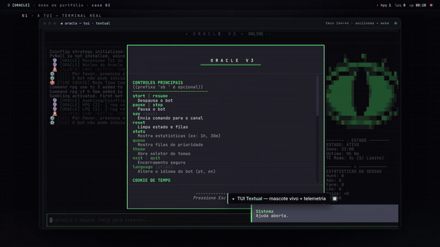

<!-- VISUAL MASCOT BANNER -->
<p align="center">
  
</p>


🇧🇷 **Para ler a documentação em Português, acesse: [README.pt-BR.md](docs/README.pt-BR.md).**

> [!WARNING]
> **This is a selfbot.** Oracle drives a real Discord user account through `discord.py-self`, which violates the Discord Terms of Service and can get the account permanently banned. Run it only on an account, and a server, you can afford to lose. Full disclaimer at the bottom.

─────── ▪ ───────

## ❯ System Diagnostics

**Oracle v3** is a selfbot daemon for Epic RPG. It listens on the Discord gateway through `discord.py-self`, drives a state machine over two priority queues (HPQ/LPQ), and answers Epic Guard captchas locally with a pair of TensorFlow Lite CNNs (16 item classes, color + grayscale variants), no external solver APIs. Sessions are observable through a Textual TUI with an animated eye mascot and a React dashboard served by FastAPI (`:8000`, REST under `/api/*`, live PTY over `/ws/terminal`). Telegram alerts and human-simulation routines (typos, jittered delays, coffee breaks, sleep windows) come built in.

> [!NOTE]
> Navi Bot and Neon Util setup required for full features.

▶ **[Watch the demo](https://github.com/thisux1/thisux1/releases/download/demos/oracle.webm)** — 31s, rendered in Oracle's own identity (Dracula palette, ASCII-eye `░▒▓█` ping-pong, scanline transitions): real Textual TUI boot → live React dashboard (overview, PTY terminal over WebSocket, config, stats) → the captcha resolver's dual-CNN routing logic → educational disclaimer. Captured offline with no Discord credentials: the daemon honestly reports the missing config instead of connecting.

## Screenshots

<p align="center">
  
  
  
</p>

<p align="center">
  <a href="https://github.com/thisux1/thisux1/releases/download/demos/oracle.webm"></a>
</p>

─────── ▪ ───────

## ❯ System Architecture & Pipelines

The diagram below details the continuous execution pipeline, handling data transmission between Discord servers, our queue system, and local machine learning models:

<p align="center">
  
</p>

### Pipeline Execution Stages
1. **Ingest/Listen**: The Discord Gateway websocket captures guild messages using `discord.py-self`.
2. **Deconstruct/Parse**: Command parsers extract events, cooldown times, and prompt parameters.
3. **Lock Resolution**: Captchas are saved, routed by grayscale detection, resized to 128×128 with Pillow/NumPy, and classified by the local **TensorFlow Lite** models. No external APIs.
4. **Humanize**: Commands pass through a delay generator introducing random intervals, simulated typing typos, and scheduled coffee/sleep cycles.
5. **Expose/Telemetry**: Session analytics are piped to the Textual TUI and FastAPI websockets to feed remote clients.

### Captcha Resolver Loop

When Epic Guard triggers a verification, `bot/captcha.py` runs this loop:

<p align="center">
  
</p>

The image is classified as grayscale or color and routed to the matching `.tflite` model. If confidence falls below **0.80**, the sibling model gets a vote and the higher score wins. The solver tries the top-3 guesses with simulated typing and per-attempt Telegram override; the Epic Guard reply (`freed`/`jailed` keywords) decides whether the queues resume or the bot halts and pages the owner.

─────── ▪ ───────

## ❯ Core Technical Specifications

```ini
[system-specification]
runtime      = Python 3.11+ + Node.js 20
gateway_lib  = discord.py-self (selfbot listener)
ai_solver    = TensorFlow Lite CNN x2 (color + gray, 128x128, 16 classes)
console_ui   = Textual TUI + Rich styling
web_backend  = FastAPI + Uvicorn + WebSocket PTY (pywinpty on Windows)
web_frontend = React 19 + Vite 6 + Tailwind CSS v4 + Zustand + xterm.js
installers   = PyInstaller + Inno Setup (OracleOS_Setup.exe via CI)
```

> On Linux/macOS, prefer Python 3.11: `tflite-runtime` ships no wheels for 3.12+. On newer interpreters, install `tensorflow` manually; the same `.tflite` models run on `tf.lite`. Windows always pulls full TensorFlow.

| Component Module | Technologies | Operational Scope |
| :--- | :--- | :--- |
| **Automation Daemon** | Python, asyncio | Process loop management, profile configurations, enqueuing routines. |
| **AI Captcha Core** | TF Lite, Pillow, NumPy | Grayscale routing, tensor prep, top-3 classification, Telegram override. |
| **Textual Terminal** | Textual, TUI themes | High-speed telemetry, animated eye mascot, theme selector, inline shell. |
| **Telemetry Endpoint** | FastAPI, WebSockets | Exposes dashboard parameters, writes modifications to config storage files. |
| **Web Dashboard** | React 19, Zustand | Remote telemetry dashboard, settings tuning, custom terminal commands. |
| **Packaging Tools** | PyInstaller, Inno | Compilation of binary packages and system installers. |

─────── ▪ ───────

## ❯ Deployment Pipeline

<details>
<summary><b>[1] Initialize Local Virtual Workspace</b></summary>
<br />

Isolate environment binaries and activate the console session:

```bash
# Create local virtual workspace:
python3 -m venv venv

# Activate (Linux/macOS):
source venv/bin/activate

# Activate (Windows CMD):
venv\Scripts\activate.bat
```
</details>

<details>
<summary><b>[2] Install Dependencies</b></summary>
<br />

Download execution libraries:

```bash
pip install --upgrade pip
pip install -r requirements.txt
```
</details>

<details>
<summary><b>[3] Setup Profile Credentials</b></summary>
<br />

Initialize the system configuration parameters by copying the sample template:

```bash
cp options_example.ini options.ini
```

(Skipped this? `options_resolver.py` copies the template for you on first boot.)

Open `options.ini` and provide your parameters:
```ini
language=en
user_token=your_discord_account_token_here
channel_id=target_discord_channel_id
guild_id=target_discord_server_id
do_hunt=true
do_adv=true
```
</details>

<details>
<summary><b>[4] Boot Oracle Console (TUI Mode)</b></summary>
<br />

Fire up the dynamic terminal monitor:

```bash
./oracle            # wraps: python main.py
```
</details>

<details>
<summary><b>[5] Deploy Dashboard Web Controller</b></summary>
<br />

Host the FastAPI server and browse local statistics:

```bash
./oracle dashboard     # wraps: python launch_dashboard.py (uvicorn + auto-open browser)
./oracle dev           # backend --reload on :8000 + Vite hot-reload on :5173
```
*Browse stats locally or connect remote dashboards to the listening websocket.*
</details>

<details>
<summary><b>[6] Build Standalone Executables</b></summary>
<br />

Compile assets and bundle Python files into single binaries:

```bash
# Compile React Dashboard Bundle:
cd dashboard
npm install
npm run build
cd ..

# Build Portable EXE:
python build_windows.py
```
</details>

<details>
<summary><b>[7] Register Global Terminal Command (Linux)</b></summary>
<br />

`setup.sh` appends an `oracle()` shell function to `~/.bashrc` / `~/.zshrc` pointing at the launcher:

```bash
chmod +x setup.sh && ./setup.sh
source ~/.bashrc
```
Launch the bot from any folder at any time by typing:
```bash
oracle
```
</details>

─────── ▪ ───────

## ❯ Repository Layout

```text
Oracle/
├── bot/                  # daemon: gateway client, state machine, queues, TUI
│   ├── client.py         # discord.py-self listener and event handlers
│   ├── captcha.py        # captcha resolver loop (routing, fallback, Telegram override)
│   ├── state.py          # bot state, HPQ/LPQ queues, human delay generator
│   ├── commands.py       # shared command executor (API/CLI/TUI/Discord)
│   ├── tui.py            # main Textual application
│   ├── tui_eye.py        # animated eye and cat mascots
│   └── ...               # parsers, handlers, telegram, summer, jail feedback
├── dashboard/            # React 19 dashboard (Vite, Tailwind v4, xterm.js)
├── dashboard_server.py   # FastAPI backend: REST /api/* + PTY over /ws/terminal
├── launch_dashboard.py   # desktop launcher: uvicorn thread + browser open
├── main.py               # TUI entrypoint (--headless for stdin pipe)
├── oracle                # bash launcher: TUI (default), dashboard, dev modes
├── options_resolver.py   # profile resolution + options.ini read/write
├── options_example.ini   # annotated config template (copied to options.ini)
├── build_windows.py      # PyInstaller bundler (frontend build + exe)
├── setup.iss             # Inno Setup script -> OracleOS_Setup.exe (CI on tags)
├── setup.sh              # registers the global `oracle` shell function
├── requirements.txt      # Python dependencies
├── classes.txt           # the 16 captcha item classes
├── oracle_v2_*.tflite    # captcha CNN weights (color + grayscale; .h5 kept as fallback)
├── data/wiki_docs/       # scraped Epic RPG wiki reference (~100 markdown docs)
├── tools/                # wiki scraper
├── docs/                 # banner.svg, architecture.svg, state-machine.svg, pt-BR README
├── plans/                # design and planning documents
└── scratch/              # one-off asset generation scripts
```

### Configuration Options

The full annotated template lives in `options_example.ini`. Key entries:

| Key | Type | Default | Description |
| :--- | :--- | :--- | :--- |
| `user_token` | string | (empty) | Discord account token (required) |
| `channel_id` / `guild_id` | int | (empty) | Target channel and server IDs |
| `language` | string | pt | `en` or `pt` |
| `admin_ids` | list | (empty) | Extra Discord IDs allowed to send `sb` commands |
| `random_interval` | bool | false | Adds 1-4s jitter between commands |
| `typo_chance` | float | 0.05 | Chance of a simulated typo per command |
| `sleep_at` / `wake_up_at` | HH:MM | (empty) | Nightly offline window |
| `telegram_bot_token` / `telegram_chat_id` | string | (empty) | Captcha alerts and remote override channel |
| `do_*` | bool | mixed | Routine toggles: `hunt`, `adv`, `farm`, `work`, `training`, `daily`, `weekly`, `quest`, `lootbox`, `dungeon`, `card_hand`, `duel`, `pet`, `summer` |
| `do_summer` | bool | false | Enable Summer Event automation |
| `summer_surf_strategy` | string | conservative | Surf risk: conservative or aggressive |
| `summer_drink_choice` | string | blue | Weekly drink color: blue, green, pink, yellow |
| `summer_use_sleepy_potion` | bool | false | Auto-use sleepy potion for weekly task (risky) |
| `theme` | string | dracula | TUI palette: cathedral, dracula, nord, monokai, gruvbox, catppuccin, tokyonight, rosepine, solarized, cyberpunk |

─────── ▪ ───────

## ❯ CLI, API & Discord Commands

Control execution via the TUI console interface, REST API, terminal stdin, or administrative Discord messages:

```text
  COMMAND             DESCRIPTION
  -----------------------------------------------------------------------------
  help                Displays shortcuts, command palettes, and manual modals.
  start / resume      Wakes up automation tasks and resumes queue listeners.
  pause / stop        Suspends commands and enqueuing threads.
  reset               Flushes state maps, command history, and queue tasks.
  stats [range]       Returns telemetry records (e.g. stats 1h, stats 45m).
  queue               Displays enqueued priority events.
  say <msg>           Sends a custom string to the configured Discord channel.
  tc start [c] [m]    Initiates Time Cookie mode (e.g. tc start 5c 60m).
  tc stop             Aborts current Time Cookie sessions.
  g start             Launches Fibonacci gambling sequence.
  g pause             Stops gambling routines.
  sleepet start       Switches execution focus to Pet Adventures.
  sleepet stop        Disables Pet Adventure loops and resumes default queue.
  theme               Loads the TUI styling palette overlay.
  exit                Gracefully shuts down services and saves logs.
```

### AI Agent & LLM Operation (Local or Cloud)

Oracle v3 natively exposes an HTTP REST API and stdin command pipe designed for AI agents (Claude Code, Cursor, Ollama, AutoGPT, custom LLM agents) to programmatically operate the bot:

#### 1. REST API Command Execution (`POST /api/exec`)
When running the dashboard backend (`python launch_dashboard.py` or `python dashboard_server.py`), issue JSON payloads to control Oracle:

```bash
# Execute any bot command (e.g. say, start, pause, reset, tc, g, sleepet):
curl -X POST http://localhost:8000/api/exec \
  -H 'Content-Type: application/json' \
  -d '{"command": "say rpg hunt", "profile": "options.ini"}'

# Activate Time Cookie mode for 3 cookies over 30 minutes:
curl -X POST http://localhost:8000/api/exec \
  -H 'Content-Type: application/json' \
  -d '{"command": "tc start 3c 30m"}'
```

#### 2. AI State & Log Inspection
AI agents can read live execution telemetry and logs via GET endpoints:
```bash
# Read execution status & queues (HPQ/LPQ):
curl http://localhost:8000/api/status?profile=options.ini

# Fetch the last 50 log lines:
curl http://localhost:8000/api/logs?profile=options.ini&limit=50
```

#### 3. Local Headless Stdin Pipe
Terminal-based agents can pipe commands directly into `main.py --headless`:
```bash
echo "say rpg hunt" | python main.py --headless
```

### Discord Remote Admin Commands (`sb ` prefix)
Authorized administrator accounts can send control commands directly in the bot's configured channel:

* `sb help` / `sb ajuda`: Displays administrative commands help.
* `sb status`: Sends a live-updating session status message to Discord & Telegram (auto-updates every 30s).
* `sb config`: Displays the interactive configuration editor and current values.
* `sb config <param> <value>`: Updates a setting dynamically (e.g. `sb config typo_chance 0.08`).
* `sb toggle <param>`: Quickly toggles a boolean configuration option (e.g. `sb toggle hunt`, `sb toggle delay`).
* `sb log`: Uploads the current session log file directly to the chat.
* `sb export [txt/ini]`: Exports current configuration settings as a file.
* `sb pause` / `sb stop`: Suspends bot automation task loops.
* `sb start` / `sb resume`: Resumes execution loops.
* `sb reset`: Flushes execution queues, cooldown timers, and resets state maps.
* `sb sleepet start` / `sb sleepet stop`: Starts or stops sleepet mode (dedicated Pet Adventure automation).
* `sb tc start [c] [m]`: Initiates Time Cookie mode (e.g., `sb tc start 5c 60m`).
* `sb tc stop` / `sb tc pause`: Disables Time Cookie mode.
* `sb g start` / `sb g stop` / `sb g pause`: Starts or stops the Fibonacci gambling sequence.
* `sb say <message>`: Sends a custom string to the active channel.

### Summer Event

| Command | Description |
|---------|-------------|
| `sb summer start` | Enable Summer Event automation |
| `sb summer stop` | Disable Summer Event automation |
| `sb summer status` | Show detailed Summer Event status |
| `sb summer sleepy` | Use sleepy potion for weekly task (manual) |

─────── ▪ ───────

## ❯ Operational Stealth & Safety Protocols

```text
  [!] USE A RESIDENTIAL CONNECTION: Avoid cloud providers (AWS, GCP, Hetzner).
  [!] TYPING TYPOS ENFORCED: Emulates human writing quirks (typo_chance=0.05).
  [!] AUTOMATED COFFEE BREAKS: Random breaks (5-15 mins) occur every 1.5h.
  [!] SLEEP DEEP SESSIONS: Sets nightly offline periods (sleep_at, wake_up_at).
  [!] TELEGRAM NOTIFIER: Sends captcha errors to remote handlers instantly.
```

─────── ▪ ───────

## ❯ Legal Warning

```text
  [WARNING]
  Oracle is a selfbot. It controls a real Discord user account through
  unofficial client APIs, which violates the Discord Terms of Service.
  Running it can get the account suspended or permanently banned.

  This project exists for education and experimentation only. Run it on
  an account, and a server, you can afford to lose. The authors accept
  no liability. Use at your own risk.
```

─────── ▪ ───────

## ❯ Licensing

Licensed under the terms of the **[MIT License](LICENSE)**. Open to modification, research, and redistribution. 

```text
  Copyright (c) 2026 Thiago Araújo
  Permission is hereby granted, free of charge, to any person obtaining a copy
  of this software and associated documentation files...
```
