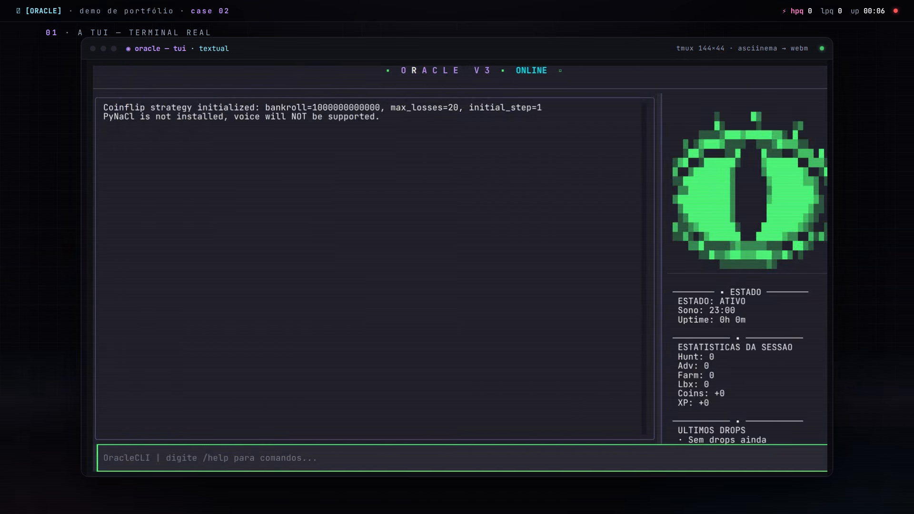
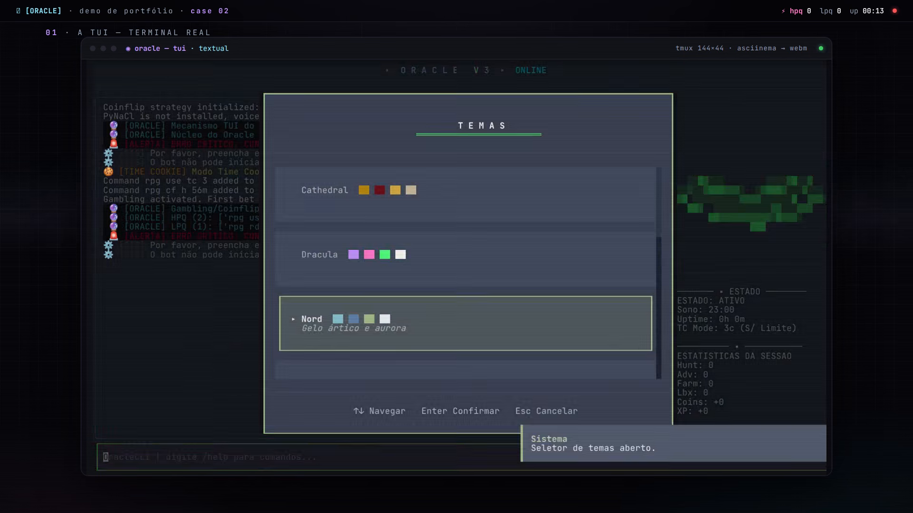
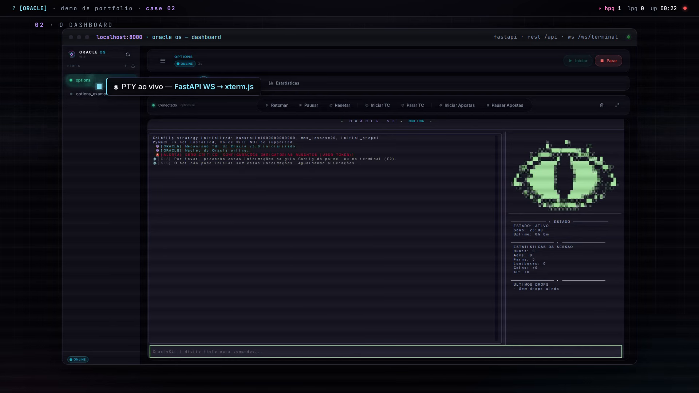

<!-- MASCOTE VISUAL DO TERMINAL -->
<p align="center">
  
</p>


🇺🇸 **For the English version of this document, see: [README.md](../README.md).**

> [!WARNING]
> **Isto é um selfbot.** O Oracle controla uma conta real de usuário do Discord via `discord.py-self`, o que viola os Termos de Serviço do Discord e pode banir a conta permanentemente. Rode somente numa conta, e num servidor, que você pode perder. Disclaimer completo no fim da página.

─────── ▪ ───────

## ❯ Diagnósticos do Sistema

O **Oracle v3** é um daemon selfbot para Epic RPG. Ele escuta o gateway do Discord via `discord.py-self`, roda uma máquina de estados sobre duas filas de prioridade (HPQ/LPQ) e resolve os captchas do Epic Guard localmente com um par de CNNs TensorFlow Lite (16 classes de itens, variantes colorida e grayscale), sem APIs externas de resolução. As sessões são observáveis via TUI em Textual com mascote de olho animado e por um dashboard React servido por FastAPI (`:8000`, REST em `/api/*`, PTY ao vivo por `/ws/terminal`). Alertas no Telegram e rotinas de humanização (typos, delays variados, pausas para café, janelas de sono) já vêm embutidos.

> [!NOTE]
> Configuração do bot Navi e do Neon Util é necessária para obter todas as funcionalidades.

▶ **[Assistir à demo](https://github.com/thisux1/thisux1/releases/download/demos/oracle.webm)** — 31s, renderizado na identidade própria do Oracle (paleta Dracula, olho ASCII `░▒▓█` em ping-pong, transições scanline): boot real da TUI em Textual → dashboard React ao vivo (overview, terminal PTY via WebSocket, config, stats) → lógica de roteamento das CNNs gêmeas do resolvedor de captcha → disclaimer educacional. Capturado offline, sem credenciais do Discord: o daemon reporta honestamente a configuração ausente em vez de conectar.

## Capturas de tela

<p align="center">
  
  
  
</p>

<p align="center">
  <video src="https://github.com/thisux1/thisux1/releases/download/demos/oracle.webm" poster="demo-poster.png" width="720" autoplay loop muted playsinline controls></video>
</p>

─────── ▪ ───────

## ❯ Arquitetura do Sistema e Fluxos de Dados

O diagrama abaixo detalha a estrutura de execução contínua, manipulando a transmissão de dados entre servidores Discord, nosso motor de filas de comando e o classificador de captchas local:

<p align="center">
  
</p>

### Fases de Execução da Automação
1. **Captura/Escuta**: O gateway de WebSocket de cliente do Discord captura as mensagens da guilda em tempo real através da biblioteca `discord.py-self`.
2. **Decomposição/Análise**: O analisador (Parser) extrai cooldowns de comandos, eventos ativos e argumentos solicitados pelas respostas de jogo.
3. **Resolução de Bloqueio**: Captchas são salvos, roteados por detecção de grayscale, redimensionados para 128×128 com Pillow/NumPy e classificados pelos modelos **TensorFlow Lite** locais. Sem APIs externas.
4. **Humanização**: As macros e ações passam pelo gerador de atraso que injeta desvios aleatórios de tempo, emulação de erros de digitação e pausa para ciclos de café e sono profundo.
5. **Telemetria**: Métricas de progresso de sessão são repassadas via sockets para atualizar a TUI do console e painéis web de forma simultânea.

### Loop do Resolvedor de Captcha

Quando o Epic Guard dispara uma verificação, o `bot/captcha.py` roda este ciclo:

<p align="center">
  
</p>

A imagem é classificada como grayscale ou colorida e roteada para o modelo `.tflite` correspondente. Se a confiança ficar abaixo de **0.80**, o modelo irmão também vota e a maior nota vence. O resolvedor tenta os 3 melhores palpites com digitação simulada e override do Telegram a cada tentativa; a resposta do Epic Guard (palavras-chave `freed`/`jailed`) decide se as filas voltam a rodar ou se o bot pausa e aciona o dono.

─────── ▪ ───────

## ❯ Especificações Técnicas de Ambiente

```ini
[system-specification]
runtime      = Python 3.11+ + Node.js 20
gateway_lib  = discord.py-self (listener selfbot)
ai_solver    = CNN TensorFlow Lite x2 (color + gray, 128x128, 16 classes)
console_ui   = Textual TUI + Estilização Rich
web_backend  = FastAPI + Uvicorn + WebSocket PTY (pywinpty no Windows)
web_frontend = React 19 + Vite 6 + Tailwind CSS v4 + Zustand + xterm.js
installers   = PyInstaller + Inno Setup (OracleOS_Setup.exe via CI)
```

> No Linux/macOS, prefira Python 3.11: o `tflite-runtime` não tem wheels para 3.12+. Em interpretadores mais novos, instale `tensorflow` manualmente; os mesmos modelos `.tflite` rodam via `tf.lite`. No Windows sempre entra o TensorFlow completo.

| Módulo do Sistema | Tecnologias | Escopo de Operação |
| :--- | :--- | :--- |
| **Daemon de Automação** | Python, asyncio | Processamento de loops, gerenciamento de perfis e orquestração de filas. |
| **Resolvedor de Captcha** | TF Lite, Pillow, NumPy | Roteamento grayscale, preparo de tensores, classificação top-3, override via Telegram. |
| **Terminal de Console** | Textual, Temas TUI | Monitoramento de telemetria rápida, mascote animado e console de comandos. |
| **Backend de Controle** | FastAPI, WebSockets | Servidor web que alimenta o dashboard e persiste alterações nos dados de configuração. |
| **Web Dashboard** | React 19, Zustand | Painel visual de controle remoto, alteração de opções e acionamento de comandos de console. |
| **Empacotadores** | PyInstaller, Inno | Geração de pacotes executáveis de instalação autônoma e portabilidade. |

─────── ▪ ───────

## ❯ Linha de Implantação

<details>
<summary><b>[1] Inicializar Workspace Virtual</b></summary>
<br />

Isole o ambiente do interpretador Python e ative os binários da sessão:

```bash
# Criar diretório virtual:
python3 -m venv venv

# Ativar (Linux/macOS):
source venv/bin/activate

# Ativar (Windows CMD):
venv\Scripts\activate.bat
```
</details>

<details>
<summary><b>[2] Instalar Pacotes de Execução</b></summary>
<br />

Baixe e atualize os requisitos da aplicação:

```bash
pip install --upgrade pip
pip install -r requirements.txt
```
</details>

<details>
<summary><b>[3] Configurar Credenciais de Perfil</b></summary>
<br />

Inicie os dados de configuração local copiando o template de exemplo:

```bash
cp options_example.ini options.ini
```

(Pulou este passo? O `options_resolver.py` copia o template para você no primeiro boot.)

Abra o arquivo `options.ini` e defina suas credenciais:
```ini
language=pt
user_token=seu_token_de_usuario_do_discord
channel_id=id_do_canal_de_mensagens
guild_id=id_da_guilda_do_servidor
do_hunt=true
do_adv=true
```
</details>

<details>
<summary><b>[4] Boot do Console Oracle (TUI Mode)</b></summary>
<br />

Inicie o painel interativo no terminal:

```bash
./oracle            # equivale a: python main.py
```
</details>

<details>
<summary><b>[5] Deploy do Dashboard de Controle Web</b></summary>
<br />

Rode o servidor local FastAPI e visualize métricas e relatórios gráficos:

```bash
./oracle dashboard     # equivale a: python launch_dashboard.py (uvicorn + abre o navegador)
./oracle dev           # backend --reload na :8000 + hot-reload do Vite na :5173
```
*Monitore dados e acesse o mini-terminal em tempo real no navegador.*
</details>

<details>
<summary><b>[6] Compilar Artefatos e Empacotar Executáveis</b></summary>
<br />

Gere builds consolidadas e empacote as dependências em um único `.exe`:

```bash
# Compilar build do Dashboard React:
cd dashboard
npm install
npm run build
cd ..

# Build do Executável Windows:
python build_windows.py
```
</details>

<details>
<summary><b>[7] Registrar Atalho Global no Terminal (Linux)</b></summary>
<br />

O `setup.sh` adiciona uma função `oracle()` no `~/.bashrc` / `~/.zshrc` apontando para o launcher:

```bash
chmod +x setup.sh && ./setup.sh
source ~/.bashrc
```
Com isso, você pode rodar o bot de qualquer pasta digitando apenas:
```bash
oracle
```
</details>

─────── ▪ ───────

## ❯ Organização das Pastas

```text
Oracle/
├── bot/                  # daemon: cliente gateway, máquina de estados, filas, TUI
│   ├── client.py         # listener discord.py-self e handlers de eventos
│   ├── captcha.py        # loop do resolvedor de captcha (roteamento, fallback, override via Telegram)
│   ├── state.py          # estado do bot, filas HPQ/LPQ, gerador de delay humano
│   ├── commands.py       # executor de comandos compartilhado (API/CLI/TUI/Discord)
│   ├── tui.py            # aplicação principal Textual
│   ├── tui_eye.py        # mascotes animados: olho e gato
│   └── ...               # parsers, handlers, telegram, summer, jail feedback
├── dashboard/            # dashboard React 19 (Vite, Tailwind v4, xterm.js)
├── dashboard_server.py   # backend FastAPI: REST /api/* + PTY via /ws/terminal
├── launch_dashboard.py   # launcher desktop: thread uvicorn + abre o navegador
├── main.py               # entrypoint da TUI (--headless para pipe via stdin)
├── oracle                # launcher bash: modos TUI (padrão), dashboard, dev
├── options_resolver.py   # resolução de perfis + leitura/escrita do options.ini
├── options_example.ini   # template de configuração anotado (copiado para options.ini)
├── build_windows.py      # empacotador PyInstaller (build do frontend + exe)
├── setup.iss             # script Inno Setup -> OracleOS_Setup.exe (CI em tags)
├── setup.sh              # registra a função global `oracle` no shell
├── requirements.txt      # dependências Python
├── classes.txt           # as 16 classes de itens do captcha
├── oracle_v2_*.tflite    # pesos das CNNs de captcha (color + grayscale; .h5 como fallback)
├── data/wiki_docs/       # referência da wiki do Epic RPG scrapeada (~100 docs markdown)
├── tools/                # scraper da wiki
├── docs/                 # banner.svg, architecture.svg, state-machine.svg, README pt-BR
├── plans/                # documentos de design e planejamento
└── scratch/              # scripts avulsos de geração de assets
```

### Opções de Configuração

O template completo e anotado está em `options_example.ini`. Principais chaves:

| Chave | Tipo | Padrão | Descrição |
| :--- | :--- | :--- | :--- |
| `user_token` | string | (vazio) | Token da conta Discord (obrigatório) |
| `channel_id` / `guild_id` | int | (vazio) | IDs do canal e do servidor alvo |
| `language` | string | pt | `en` ou `pt` |
| `admin_ids` | lista | (vazio) | IDs extras do Discord autorizados a enviar comandos `sb` |
| `random_interval` | bool | false | Adiciona jitter de 1-4s entre comandos |
| `typo_chance` | float | 0.05 | Chance de typo simulado por comando |
| `sleep_at` / `wake_up_at` | HH:MM | (vazio) | Janela offline noturna |
| `telegram_bot_token` / `telegram_chat_id` | string | (vazio) | Alertas de captcha e canal de override remoto |
| `do_*` | bool | misto | Toggles de rotinas: `hunt`, `adv`, `farm`, `work`, `training`, `daily`, `weekly`, `quest`, `lootbox`, `dungeon`, `card_hand`, `duel`, `pet`, `summer` |
| `do_summer` | bool | false | Ativa a automação do Evento Summer |
| `summer_surf_strategy` | string | conservative | Estratégia de risco no Surf: conservative ou aggressive |
| `summer_drink_choice` | string | blue | Cor da bebida da segunda-feira: blue, green, pink, yellow |
| `summer_use_sleepy_potion` | bool | false | Uso automático de sleepy potion para a task semanal (arriscado) |
| `theme` | string | dracula | Paleta da TUI: cathedral, dracula, nord, monokai, gruvbox, catppuccin, tokyonight, rosepine, solarized, cyberpunk |

─────── ▪ ───────

## ❯ Comandos CLI, API & Discord

Controle a execução através da interface TUI do terminal, da REST API, do stdin de terminal ou enviando mensagens diretas no chat do Discord (restrito a admins):

```text
  COMANDO             DESCRIÇÃO
  -----------------------------------------------------------------------------
  help                Exibe atalhos do teclado, menu de comandos e manual.
  start / resume      Ativa os loops de automação e retoma filas.
  pause / stop        Suspende envio de comandos e threads em background.
  reset               Limpa estados do bot, filas e cooldowns.
  stats [período]     Retorna dados da sessão de progresso (ex. stats 1h, stats 45m).
  queue               Mostra o tamanho da fila e comandos agendados.
  say <msg>           Envia uma string customizada no canal configurado.
  tc start [c] [m]    Ativa o modo Time Cookie (ex. tc start 5c 60m).
  tc stop             Para o modo Time Cookie ativo.
  g start             Inicia rotina de gambling/apostas Fibonacci.
  g pause             Interrompe rotinas de gambling.
  sleepet start       Redireciona escopo para resgate de Pet Adventures.
  sleepet stop        Desativa busca de pets e retorna rotinas normais.
  theme               Carrega a tela de seleção de paleta visual da TUI.
  exit                Encerra processos e persiste arquivos de log.
```

### Operação por Agentes de IA & LLMs (Local ou Nuvem)

O Oracle v3 dispõe de uma REST API HTTP e leitura via pipe stdin projetadas especificamente para que agentes de IA (Claude Code, Cursor, Ollama, AutoGPT, agentes LLM customizados) possam operar o bot de forma programática:

#### 1. Execução de Comandos via REST API (`POST /api/exec`)
Com o backend do dashboard em execução (`python launch_dashboard.py` ou `python dashboard_server.py`), envie requisições JSON para controlar o Oracle:

```bash
# Executar qualquer comando do bot (ex: say, start, pause, reset, tc, g, sleepet):
curl -X POST http://localhost:8000/api/exec \
  -H 'Content-Type: application/json' \
  -d '{"command": "say rpg hunt", "profile": "options.ini"}'

# Ativar o modo Time Cookie para 3 cookies em 30 minutos:
curl -X POST http://localhost:8000/api/exec \
  -H 'Content-Type: application/json' \
  -d '{"command": "tc start 3c 30m"}'
```

#### 2. Inspeção de Estado e Logs para IA
Agentes de IA podem ler a telemetria ao vivo e logs através dos endpoints GET:
```bash
# Obter status de execução e tamanho das filas (HPQ/LPQ):
curl http://localhost:8000/api/status?profile=options.ini

# Ler as últimas 50 linhas do log:
curl http://localhost:8000/api/logs?profile=options.ini&limit=50
```

#### 3. Pipe Stdin em Modo Headless Local
Agentes baseados em terminal podem injetar comandos diretamente no stdin do `main.py --headless`:
```bash
echo "say rpg hunt" | python main.py --headless
```

### Comandos de Controle Remoto no Discord (Prefixo `sb `)
Contas administradoras autorizadas podem controlar o daemon enviando comandos diretamente no canal configurado:

* `sb help` / `sb ajuda`: Exibe a ajuda dos comandos administrativos.
* `sb status`: Envia uma mensagem de status em tempo real para o Discord e Telegram (com atualização automática a cada 30 segundos).
* `sb config`: Exibe o painel de configurações dinâmicas e os valores atuais dos parâmetros.
* `sb config <parametro> <valor>`: Altera dinamicamente um parâmetro do arquivo `options.ini` (ex: `sb config typo_chance 0.08`).
* `sb toggle <parametro>`: Alterna rapidamente o valor de um parâmetro booleano (ex: `sb toggle hunt`, `sb toggle delay`).
* `sb log`: Envia o arquivo de log da sessão atual diretamente no chat.
* `sb export [txt/ini]`: Exporta o arquivo de configurações atual.
* `sb pause` / `sb stop`: Pausa a execução dos loops de automação.
* `sb start` / `sb resume`: Retoma o envio de comandos e loops de automação.
* `sb reset`: Limpa as filas de comandos, timers de cooldown e reseta o estado geral do bot.
* `sb sleepet start` / `sb sleepet stop`: Ativa ou desativa o modo sleepet (automação focada em Pet Adventures).
* `sb tc start [c] [m]`: Inicia o modo Time Cookie (ex: `sb tc start 5c 60m`).
* `sb tc stop` / `sb tc pause`: Encerra o modo Time Cookie ativo.
* `sb g start` / `sb g stop` / `sb g pause`: Ativa ou desativa as rotinas do módulo de gambling/apostas Fibonacci.
* `sb say <mensagem>`: Envia uma mensagem personalizada no canal ativo.

### Evento Summer

| Comando | Descrição |
|---------|-----------|
| `sb summer start` | Ativa a automação do Evento Summer |
| `sb summer stop` | Desativa a automação do Evento Summer |
| `sb summer status` | Exibe o status detalhado do Evento Summer |
| `sb summer sleepy` | Usa a porção sleepy para a task semanal (manual) |

─────── ▪ ───────

## ❯ Protocolos de Segurança e Anti-Detecção

```text
  [!] USE CONEXÃO RESIDENCIAL: Evite hostings comerciais (AWS, GCP, DigitalOcean).
  [!] ERROS DE DIGITAÇÃO: Emula falhas humanas de digitação de comando (typo_chance=0.05).
  [!] PAUSAS DO CAFÉ: Pausas dinâmicas automatizadas (5 a 15 min) a cada 1.5 horas.
  [!] CICLOS DE SONO: Períodos off configuráveis para dormir à noite (sleep_at, wake_up_at).
  [!] NOTIFICAÇÃO TELEGRAM: Alertas imediatos em captchas duvidosos.
```

─────── ▪ ───────

## ❯ Aviso Legal

```text
  [AVISO]
  O Oracle é um selfbot. Ele controla uma conta real de usuário do Discord
  através de APIs não-oficiais, o que viola os Termos de Serviço do Discord.
  Rodá-lo pode resultar em suspensão ou banimento permanente da conta.

  Este projeto existe apenas para fins educacionais e de experimentação.
  Rode numa conta, e num servidor, que você pode perder. Os autores não
  assumem qualquer responsabilidade. Use por sua conta e risco.
```

─────── ▪ ───────

## ❯ Termos de Licenciamento

Sob os termos da licença de código aberto **[MIT License](../LICENSE)**. Permissivo para modificação, estudo acadêmico e redistribuição.

```text
  Copyright (c) 2026 Thiago Araújo
  Permission is hereby granted, free of charge, to any person obtaining a copy
  of this software and associated documentation files...
```
