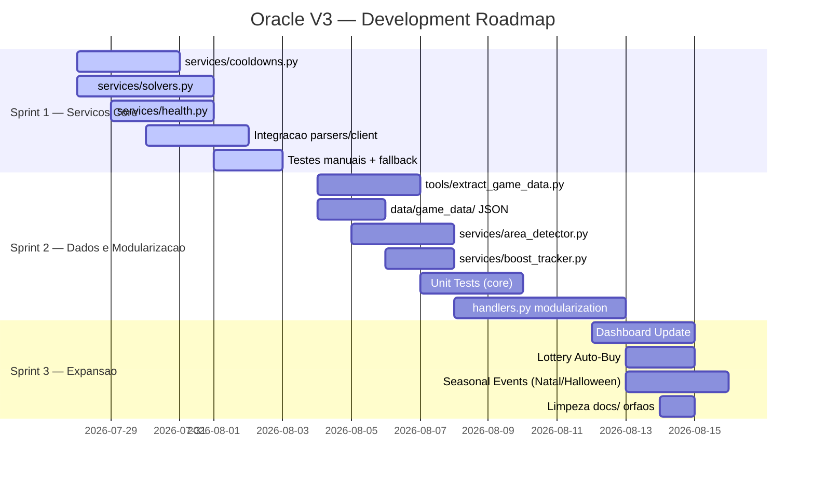

# Matriz de Prioridades — Oracle V3

> Priorizacao de todas as features baseada em: impacto no usuario, urgencia, disponibilidade de dados de referencia e esforco de implementacao.
> **Revisao em 2026-07-26** — Inclui justificativas, trade-offs e cenario atual (nada implementado).

---

## 1. Metodo de Priorizacao

Cada feature e avaliada em 5 eixos (1-5):

| Eixo | Peso | Descricao |
|---|---|---|
| **Impacto** | 25% | Valor agregado para o usuario |
| **Urgencia** | 25% | O quanto a dependencia externa (Navi) impacta |
| **Dados Ref** | 20% | Disponibilidade de dados de referencia (Navi/Guide/Wiki) |
| **Esforco** | 15% | Complexidade de implementacao (invertido: 5 = facil) |
| **Risco** | 15% | Risco de quebrar funcionalidade existente (invertido: 5 = seguro) |

**Score = Impacto x 0.25 + Urgencia x 0.25 + Dados x 0.20 + Esforco x 0.15 + Risco x 0.15**

### Justificativa da Mudanca de Pesos

| Eixo | Peso Antigo | Peso Novo | Motivo |
|---|---|---|---|
| Impacto | 0.30 | 0.25 | Reduzido porque impacto e subjetivo sem metricas de uso |
| Urgencia | 0.30 | 0.25 | Reduzido porque a bridge Navi funciona (nao e urgencia absoluta) |
| Dados Ref | 0.20 | 0.20 | Mantido — dados de referencia sao essenciais |
| Esforco | 0.20 | 0.15 | Reduzido — esforco e variavel, depende de quem implementa |
| Risco | — | 0.15 | Novo — crucial para selfbot onde bugs podem causar ban |

---

## 2. Matriz Completa (Revisada)

| # | Feature | Imp | Urg | Dad | Esf | Ris | Score | Prioridade |
|---|---|---|---|---|---|---|---|---|
| 1 | **TrainingSolver (River/Field/Casino/Forest)** | 5 | 5 | 5 | 4 | 4 | **4.65** | 🔴 Critica |
| 2 | **TrainingSolver (Ruby/Mine/Void)** | 4 | 5 | 5 | 5 | 4 | **4.55** | 🔴 Critica |
| 3 | **CooldownManager** | 5 | 4 | 5 | 4 | 3 | **4.30** | 🔴 Alta |
| 4 | **HealthMonitor** | 5 | 4 | 5 | 4 | 3 | **4.30** | 🔴 Alta |
| 5 | **PetCatchSolver** | 4 | 4 | 5 | 3 | 4 | **4.05** | 🔴 Alta |
| 6 | **AreaDetector** | 4 | 3 | 5 | 3 | 4 | **3.80** | 🟡 Media-Alta |
| 7 | **handlers.py modularization** | 5 | 4 | 4 | 2 | 2 | **3.55** | 🟡 Media |
| 8 | **RubyTracker multi-source** | 3 | 3 | 5 | 4 | 4 | **3.70** | 🟡 Media-Alta |
| 9 | **BoostTracker** | 4 | 3 | 4 | 4 | 4 | **3.75** | 🟡 Media-Alta |
| 10 | **GameData (monstros, areas, trades)** | 3 | 3 | 5 | 3 | 5 | **3.70** | 🟡 Media-Alta |
| 11 | **Lottery Auto-Buy** | 3 | 2 | 3 | 3 | 4 | **2.95** | 🟢 Media-Baixa |
| 12 | **Unit tests (pytest)** | 4 | 3 | 3 | 3 | 5 | **3.60** | 🟡 Media |
| 13 | **Seasonal Events (handler basico)** | 3 | 2 | 4 | 3 | 4 | **3.10** | 🟢 Media-Baixa |
| 14 | **Global Events Auto-Join** | 2 | 1 | 3 | 2 | 3 | **2.15** | 🔵 Baixa |
| 15 | **Dashboard Update (novos servicos)** | 3 | 2 | 3 | 3 | 4 | **2.95** | 🟢 Media-Baixa |
| 16 | **Dungeon Auto 16+** | 2 | 1 | 2 | 2 | 2 | **1.80** | 🔵 Baixa |
| 17 | **GameData (horse, pets, alchemy, etc)** | 2 | 1 | 4 | 3 | 5 | **2.80** | 🟢 Media-Baixa |
| 18 | **Extract data script (tools/)** | 3 | 2 | 4 | 4 | 5 | **3.40** | 🟡 Media |

### Itens Removidos (da matriz original)

| Feature | Score Antigo | Score Novo | Motivo da Remocao |
|---|---|---|---|
| **Auto-flex (loot announce)** | Removido | — | Selfbot stealth — enviar loot publicamente gera padroes detectaveis |
| **Multi-language detection** | Removido | — | Oracle e EN-only. Parsers traduzir esta fora de escopo. Esforco alto, retorno baixo |
| **SQLite migration** | Removido | — | JSON mantido para session data. SQLite sem ganho real para single-user selfbot |

### Itens Adicionados (nesta revisao)

| Feature | Score | Justificativa |
|---|---|---|
| **Extract data script (tools/)** | 3.40 | Essencial para gerar data/game_data/*.json. Sem ele, GameData nao tem dados. |
| **GameData (horse, pets, alchemy, etc)** | 2.80 | Subconjunto de dados do jogo, util mas nao critico para operacao basica. |

---

## 3. Comparacao com Scores Anteriores

| Feature | Score Antigo (v1) | Score Novo (v2) | Diferenca | Justificativa |
|---|---|---|---|---|
| TrainingSolver (River/Field/Casino/Forest) | 4.8 | 4.65 | -0.15 | Risco adicionado ao calculo |
| CooldownManager | 4.5 | 4.30 | -0.20 | Risco de integracao com client.py |
| HealthMonitor | 4.5 | 4.30 | -0.20 | Risco de falsos positivos (heal desnecessario) |
| PetCatchSolver | 4.0 | 4.05 | +0.05 | Dados de referencia do Guide sao excelentes |
| AreaDetector | 3.8 | 3.80 | 0 | Mesmo |
| handlers.py modularization | 3.9 | 3.55 | -0.35 | Risco ALTO de quebrar fluxo existente |
| BoostTracker | 3.7 | 3.75 | +0.05 | Navi boosts.py e referencia solida |
| GameData Init | 3.4 | 3.70 | +0.30 | Risco baixissimo (dados estaticos) |

---

## 4. Sprint Atual (Plano 1 — Independencia do Navi)

### Features Prioritarias

```
TrainingSolver (solvers.py)   [Score 4.65] — Strategy Pattern, 6 solvers
CooldownManager (cooldowns.py) [Score 4.30] — Timers internos, donor/event reduction
HealthMonitor (health.py)      [Score 4.30] — Formula Navi, casos especiais
PetCatchSolver (solvers.py)    [Score 4.05] — Lowest Risk + Higher Skill
RubyTracker (solvers.py)       [Score 3.70] — Multi-source tracking
```

### Nota sobre CooldownManager + Navi + `rd`

O CooldownManager **nao substitui** `rpg rd` nem o Navi bridge. Eles coexistem:

- **`rpg rd`** (client.py:680-683, a cada 120s): fonte de verdade absoluta para calibragem dos timers
- **CooldownManager**: timer local para anti-spam de `rd` — evita mandar `rd` para comandos que se sabe que ainda estao em cooldown
- **Navi bridge**: detecta comandos prontos via slash commands do Navi Lite (fallback)
- Anti-spam de 5s (`ANTI_SPAM_WINDOW`, client.py:518/556) + `response_pending_until` (client.py:534-535) garantem que nao ha duplicacao de comandos entre fontes

### Arquivos a Criar/Modificar

| Arquivo | Tipo | Descricao | Prioridade |
|---|---|---|---|
| `bot/services/cooldowns.py` | NOVO | CooldownManager (anti-spam de rd) | 🔴 Critico |
| `bot/services/solvers.py` | NOVO | TrainingSolver + PetCatchSolver + RubyTracker | 🔴 Critico |
| `bot/services/health.py` | NOVO | HealthMonitor (formula Navi) | 🔴 Alto |
| `bot/handlers.py` | MODIFICAR | Extrair blocos para services/; Navi vira fallback | 🔴 Alto |
| `bot/parsers.py` | MODIFICAR | Marcar cooldowns nos parsers | 🔴 Alto |
| `bot/client.py` | MODIFICAR | Cooldown check no loop principal | 🔴 Alto |
| `bot/state.py` | MODIFICAR | Global service instances | 🔴 Alto |
| `bot/config.py` | MODIFICAR | Novas configs (use_internal_timers, etc) | 🔴 Alto |

---

## 5. Sprint 2 — Dados, Deteccao e Modularizacao

| Feature | Score | Risco | Depende de |
|---|---|---|---|
| handlers.py Modularization | 3.55 | 🟡 Medio (pode quebrar fluxo) | Plano 1 completo |
| AreaDetector | 3.80 | 🟢 Baixo | GameData + MONSTERS_AREA |
| BoostTracker | 3.75 | 🟢 Baixo | HealthMonitor (integracao) |
| GameData JSON Init | 3.70 | 🟢 Baixissimo | tools/extract_game_data.py |
| Extract Data Script | 3.40 | 🟢 Baixissimo | Acesso ao Guide + Navi |
| Unit Tests | 3.60 | 🟢 Baixissimo | Services implementados |

### Ordem Recomendada

```
1. tools/extract_game_data.py  (gera os JSONs)
2. GameData singleton          (carrega os JSONs)
3. AreaDetector                (usa GameData.MONSTERS_AREA)
4. BoostTracker                (usa GameData.BOOSTS)
5. Unit Tests para services/   (cooldowns, solvers, health)
6. handlers.py modularization  (ULTIMO — maior risco)
```

---

## 6. Sprint 3 — Expansao e Dashboard

| Feature | Score | Risco | Observacao |
|---|---|---|---|
| Dashboard Update | 2.95 | 🟢 Baixo | Endpoints para cooldown timers, area atual, health status |
| Lottery Auto-Buy | 2.95 | 🟢 Baixo | Compra automatica de loteria, ciclo de 12h |
| Seasonal Events | 3.10 | 🟡 Medio | Handler Natal, Halloween, etc. Priorizar Christmas e Halloween |
| GameData (completo) | 2.80 | 🟢 Baixissimo | horse, pets, alchemy, artifacts, cards |

### Futuro (sem data)

- Global Events Auto-Join (Score 2.15 — opcional)
- Dungeon Auto 16+ (Score 1.80 — sem dados de referencia suficientes)
- Unit Tests avancados (cobertura > 80%)

---

## 7. Roadmap Visual



---

## 8. Arvore de Decisao para Priorizacao

```
Feature nova
│
├→ Depende de Navi bridge?
│   YES → Score > 4.0? → Implementar AGORA
│   │                    (Plano 1: cooldowns, training, heal, pet)
│   │
│   NO  → Dados de referencia disponiveis?
│         YES → Score > 3.5? → Sprint 2
│         │                    (AreaDetector, BoostTracker, GameData)
│         │
│         NO  → Impacto direto para usuario?
│               YES → Score > 3.0? → Sprint 3
│               │                    (Eventos sazonais, Lottery)
│               │
│               NO  → Agendar para futuro
│                     (Dungeon 16+, Global Events)
```

---

## 9. Justificativas de Decisoes

### Por que TrainingSolver e a maior prioridade?
- **Dependencia critica:** Oracle nao consegue fazer training sem Navi
- **Dados completos:** Navi helper_training.py tem toda a logica pronta (MIT license)
- **Baixo risco:** Solvers sao funcoes puras (input → output), facilmente testaveis

### Por que handlers.py modularizacao tem prioridade media?
- **Alto risco:** refatorar 3287 linhas de codigo de producao sem testes pode introduzir bugs
- **Depende de Plano 1:** so faz sentido modularizar apos remover a bridge Navi
- **Beneficio indireto:** melhora manutencao, mas nao adiciona funcionalidades novas

### Por que Seasonal Events tem prioridade baixa?
- Eventos sazonais ocorrem poucas semanas por ano
- Oracle funciona sem eles (nao ha dependencia)
- Cada handler requer ~1-2 dias de implementacao e teste
- Retorno sobre investimento baixo comparado a outras features

### Por que Lottery Auto-Buy tem prioridade baixa?
- Navi so detecta, nao compra automaticamente — entao nao ha urgencia
- Ciclo de 12h significa interacao minima do usuario
- Beneficio marginal comparado a outras features

### Por que Dashboard Update tem prioridade baixa?
- Dashboard ja existe e funciona
- Adicionar novos endpoints e trivial quando os servicos estiverem prontos
- Nao bloqueia outras features
